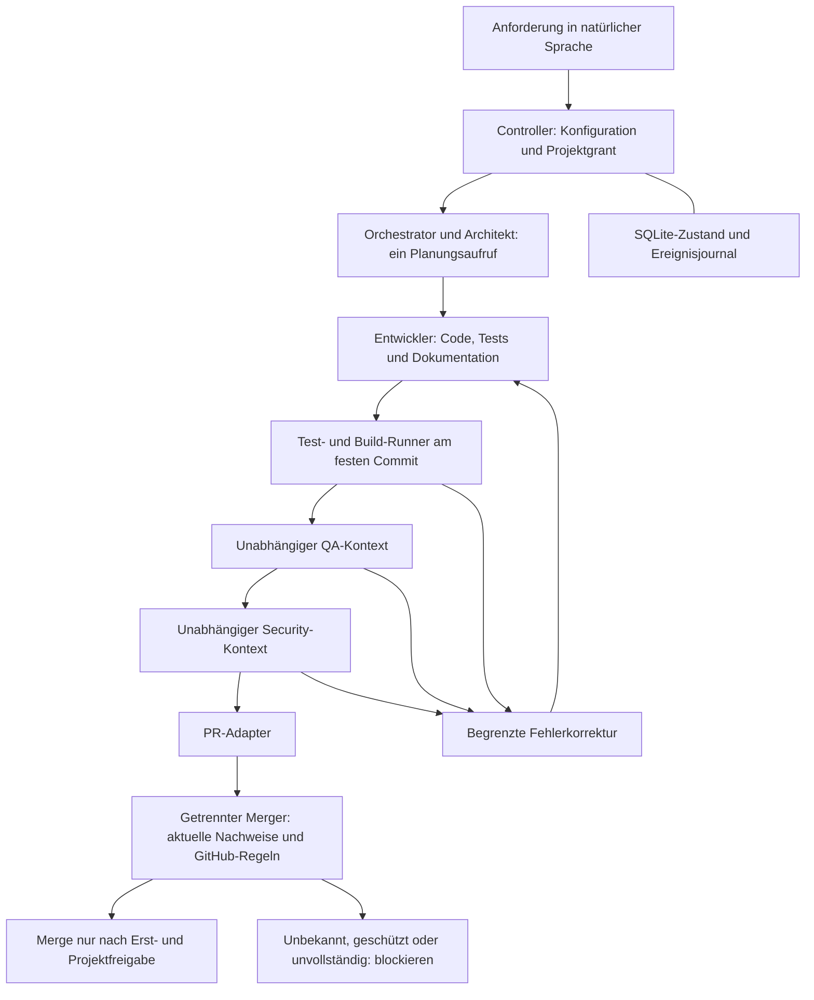

# Architektur und Rollen

Der Kern ist projektunabhängig: Er verarbeitet Anforderungen, versionierte
Projektregeln und typisierte Adapterergebnisse. Python übernimmt die Steuerung;
die Zielsoftware kann eine andere Sprache und Architektur verwenden. Der mitgelieferte
synthetische Agentenadapter kennt ein Python-Beispiel; `CodexCloudAgents` übermittelt
freie Anforderungen über denselben `AgentBackend`-Vertrag. Es gibt weiterhin genau
einen Zustandsautomaten, dieselben Korrekturschleifen und dasselbe Merge-Gate.

| Rolle | Verantwortung | Technischer Vertrag / Ausgabe |
| --- | --- | --- |
| Orchestrator | Anforderung analysieren, messbare Abnahmekriterien und Aufgaben festlegen, Ablauf/Budgets überwachen | `Planning.plan`, eindeutige Kriterien-IDs und Aufgaben |
| Architekt | Bestehende Struktur, Abhängigkeiten, Schnittstellen und Risiken prüfen | `Planning.architecture` mit Zusammenfassung, Abhängigkeiten und Risiken |
| Entwickler | Implementierung, Tests, Dokumentation und gezielte Korrekturen | `AgentBackend.develop`; Commit durch Controller |
| QA | Finalen Commit unabhängig prüfen; alle Kriterien, Randfälle und Abdeckung bewerten | `Review` mit Ergebnis, Kriterienabdeckung und Befunden |
| Security | Rechte, sensible Daten, Abhängigkeiten und geschützte Komponenten prüfen | Separates `Review`; unauflösbarer Richtlinienkonflikt eskaliert |

Der Merger ist eine getrennte **technische Berechtigung**, keine sechste KI-Rolle.
Keine Rolle kann aus einer Projektdatei Rechte erhalten. Rollenprompts sind
Hilfestellungen; sie ersetzen keine vom Betreiber erzwungene Isolation.

Orchestrator und Architekt dürfen in einem Aufruf arbeiten, solange beide Ausgaben
vorliegen. Der synthetische Erfolgsfall braucht damit vier Agentenaufrufe. QA und
Security erhalten jeweils einen eigenen Prüfaufruf und unterscheiden sich vom
Entwickler. Reviews laufen erst nach erfolgreichen Pflichtprüfungen. Bei Änderungen
werden keine alten Review-Ergebnisse wiederverwendet. Ein Live-Adapter muss den
Review-Kontext auf Anforderung, Kriterien, Richtlinien, unveränderlichen Diff und
Prüfergebnisse begrenzen; Entwickler-Selbsteinschätzungen sind keine Review-Belege.

## Module

| Modul | Funktion |
| --- | --- |
| `config.py` | Striktes TOML, Typ-/Pfad-/Budgetprüfung, geschützte Dateimuster |
| `models.py`, `roles.py` | Unveränderliche Datenträger, Zustände und Rollenrichtlinien |
| `engine.py` | Zustandsautomat, Fehlerklassen, Korrekturen, Invalidation und Eskalation |
| `workspace.py`, `execution.py` | Synthetische Git-Operationen und begrenzte lokale Prozesse |
| `store.py` | Transaktionale Zustands-/Ereignisspeicherung und exklusive Laufsperren |
| `authority.py`, `gate.py` | Controller-Grants, lokale Belegregistrierung und Merge-Entscheidung |
| `adapters/base.py` | Austauschbare Agenten- und Delivery-Verträge |
| `adapters/synthetic.py` | Deterministischer Testtreiber, unabhängige QA-Probe, simulierte PRs |
| `adapters/github.py` | Echte REST-Aufrufe über `gh`; getrennte Leser-, PR- und Merge-Objekte |
| `adapters/codex_cloud.py` | Experimenteller CLI-Gateway ohne erfundene Cloud-HTTP-Endpunkte |
| `adapters/cloud_agents.py` | Cloud-Aufträge für die vorhandenen Rollenstufen; manuelle Übergabe ohne Merger |
| `adapters/cloud_contracts.py`, `adapters/cloud_results.py` | Laufgebundene Freigabe, striktes Ergebnisschema und isolierter Diff-Import |
| `cli.py` | Ausschließlich Demo, Konfigurationsprüfung, lokale Anzeige und CLI-Probe |

`AgentBackend` und `DeliveryBackend` erlauben andere Entwicklungsdienste oder
Plattformen. DT-002 ergänzt im vorhandenen Treiber einen ausdrücklich freizugebenden
Cloud-Pilotpfad. `CloudPending` pausiert die aktuelle Stufe; dieselbe Job-ID wird später
weiter abgefragt. SQLite hält Auftrags-, Poll-, Zeit- und Korrekturbudgets über Neustarts.
Die Standard-CLI bleibt im sicheren Testmodus. Der Pilot endet immer am Merge-Gate
mit einer lokalen Übergabevorschau; echte PR-Erstellung und Merger sind nicht angeschlossen.
Ergebnisbindung und getrennte Tasks bestätigen noch keine attestierte Cloud-Laufzeit.
Vertrag, Grenzen und Freigabebedarf stehen in [dt-002.md](dt-002.md).
